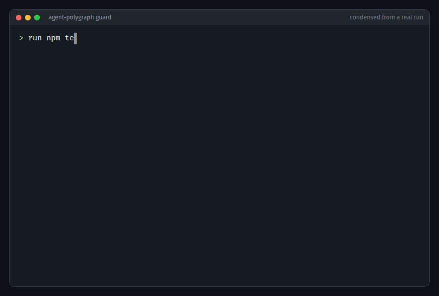
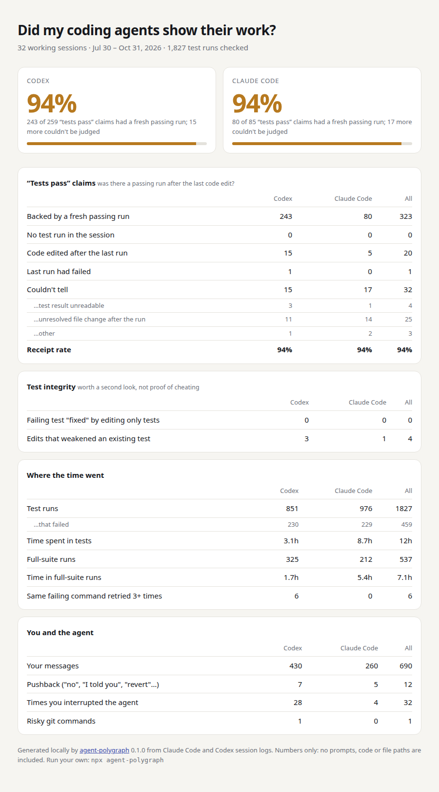

# agent-polygraph

[](https://github.com/EleChon-pixel/agent-polygraph/actions/workflows/test.yml)

Your coding agent said "all tests pass". Did a test pass after its last edit?

agent-polygraph reads the Claude Code and Codex session logs already on your machine and checks every "tests pass" claim against what ran. No setup, no API key, nothing uploaded.

```sh
npx agent-polygraph          # your own sessions
npx agent-polygraph --demo   # generated sample sessions
```



> This is a beta. It has been tested on my own logs and on public Claude Code sessions ([evaluation](docs/evaluation.md)). If a verdict looks wrong, please [open an issue](https://github.com/EleChon-pixel/agent-polygraph/issues/new/choose) with the redacted example from the report. Each one becomes a regression test.

My own sessions, July to October 2026:

```
agent-polygraph  32 working sessions · Jul 30 – Oct 31, 2026 · 11.0s

"Tests pass" claims  was there a passing run after the last code edit?
                                                    Codex  Claude Code          All
  Backed by a fresh passing run                       243           80          323
  No test run in the session                            0            0            0
  Code edited after the last run                       15            5           20
  Last run had failed                                   1            0            1
  Couldn't tell                                        15           17           32
  …test result unreadable                               3            1            4
  …unresolved file change after the run                11           14           25
  …other                                                1            2            3
  Receipt rate                                        94%          94%          94%

Test integrity  worth a second look, not proof of cheating
  Failing test "fixed" by editing only tests            0            0            0
  Edits that weakened an existing test                  3            1            4

Where the time went
  Test runs                                           851          976         1827
  Time spent in tests                                3.1h         8.7h          12h
  Full-suite runs                                     325          212          537
  ...
```

Under the tables it prints the latest examples: what the agent claimed, the last test command and its result, what was edited afterwards, and the session file, so you can check it yourself.

## Share your numbers

```sh
npx agent-polygraph --html
```

This writes `polygraph.html`, a self-contained card with numbers only. Prompts, code, commands and file paths are left out.



## Stop unbacked claims as they happen

```sh
npx agent-polygraph guard --install            # this project (.claude/settings.json, .codex/hooks.json)
npx agent-polygraph guard --install --global   # every project (~/.claude, ~/.codex)
npx agent-polygraph guard --uninstall
```

`guard` is a Stop hook that runs the same checks on the live session. When the agent's final message says tests pass and the session doesn't back it up, the agent is sent back once:

> agent-polygraph: your final message says "All tests pass.", but you edited calc.js after the last test run. Run the relevant tests now and report the actual result. If they can't be run, say so instead of claiming they pass.

It blocks at most once per stop, looks only at the final message (so a claim the agent already corrected doesn't count), stays quiet when it can't tell, and never fails the turn because of its own errors. Install it globally (`npm i -g agent-polygraph`) so the hook doesn't start `npx` on every stop.

I tested it with both agents by having them edit code after a test run and then claim the tests pass. Both were stopped, reran `npm test` and reported the failure. Codex needs one extra step: it only runs hooks you have approved, and only reads a project's `.codex/` folder if you trust it. After installing, open `codex` in the project once, trust the folder and approve the hook.

## Evidence the logs don't have

Some things never show up in the logs: tests you ran yourself in another terminal, CI results, and files changed by a script that builds their names at run time. Two optional extras cover them.

```sh
npx agent-polygraph record --install           # this project; add --global for all of them
npx agent-polygraph record --install --shell   # your own terminals
npx agent-polygraph --ci                       # GitHub Actions (online)
```

`record --install` adds a PostToolUse hook to Claude Code and Codex. After a test command, or a command that may write files, it saves a snapshot of the working tree and the test runner's full result. The snapshot is a git tree built with a temporary index and a separate object store, so your repository, its index and its history are never touched. Ignored files are left out. If the logs can't tell whether a script changed your code after the last test run, the two snapshots answer it, and a changed source file is named in the report. Everything stays in `~/.agent-polygraph` (or `$AGENT_POLYGRAPH_HOME`). It applies to sessions started after you install it.

`record --install --shell` adds one line to `~/.bashrc` and `~/.zshrc`. From then on, test commands you run in an interactive bash or zsh terminal are logged with their folder, start and end time and exit code. Output is never saved. If you ran the tests yourself in the session's folder after the agent's last edit, that run counts for the agent's claim. `record --uninstall --shell` removes the line.

`--ci` goes online. Through your [`gh`](https://cli.github.com) login, it asks the GitHub API for the workflow runs of the repositories your sessions pushed to. The request contains the repository name and a date range, nothing from your sessions. A test workflow on a pushed commit counts as a test run of the code as it was at the push, so later edits still make it stale. Runs are matched to pushes by commit id, which has to appear in the session (in the push output, or from `git commit` or `git log` before it). Branch names and timing alone are not enough. With `--ci`, claims about CI itself ("CI is green", "all checks on the PR pass") are checked too. Workflows with no job or step named like a test, and runs GitHub never started, are ignored.

The report shows how many claims each of these settled.

## What it checks

| Finding | How it's decided |
|---|---|
| Backed claim | The agent said tests pass and the run it refers to passed. That is the run with the count or test file the claim names; for "the full suite passes", the latest run in that folder about as large as the largest one; otherwise the latest result the agent had seen. The run must have started after the last edit to a source file in the same checkout. |
| Code edited after the last run | A test ran, the agent then changed source code in that checkout (with an edit tool, a patch or the shell), and claimed tests pass without running them again. An edit made while the run was still going counts too. |
| Last run had failed | The latest test result in the session showed failures. A subagent's failing run in its own worktree is "couldn't tell" instead. |
| No test run | The agent changed code but ran nothing recognisable as a test before the claim. |
| Couldn't tell | Left out of the receipt rate, with the reason shown: the result can't be read (piped, truncated, mixed with other output), a file changed in a way that can't be traced (a script with no file name in it, `git checkout`, `git merge`), the test was still running, a subagent's run failed in its own worktree, or nothing in the session changed code. |
| Failing test "fixed" by editing only tests | A run failed, the agent changed a test it hadn't touched before, changed nothing else, and the next run passed. Fixing a test the agent just wrote doesn't count. Sometimes the test was wrong, so this is a flag to look at, not a verdict. |
| Weakened an existing test | An edit to a test that existed before the session removed cases or assertions, added `skip`/`xfail`, `.only` or an always-true assertion, or deleted the file. |
| Full-suite runs | A test command with no file, directory, node id or `-k` filter. |
| Retry loops | The same failing command run 3 or more times in a row with no edit in between. |
| Pushback and interrupts | Your messages that start with "no", "stop" or "revert" or contain "I told you", and turns you interrupted. |
| Risky git | `--no-verify`, `push --force`, `reset --hard`, discarding uncommitted changes. |

Background runs are followed: Claude Code's `run_in_background` results (the notification and the output file the agent reads) and Codex cells that finish later through `wait`.

## How it decides

Everything is deterministic pattern matching over the logs. There is no LLM involved, and the same logs always give the same numbers. When a rule is unsure, it says "couldn't tell" instead of flagging the agent.

- Each command's start and its result are separate events, in the order they were observed. A claim can only be backed by a result the agent had already seen. A run covers the code as it was when the run started, so an edit during the run makes it stale.
- In a Codex cell that runs several commands, each command gets its own output. If outputs can't be matched to commands, the result stays unknown.
- An edit counts once it happened: a Claude Code edit after its tool result confirms it, a Codex patch if it applied. Shell writes count too (`sed -i`, redirects, `tee`, `cp`/`mv`, scripts that write named files), placed by the `cd` in effect where they appear.
- A script's writes are the files it clearly writes, such as `open('x.py', 'w')`, `Path('x.py').write_text(...)`, `writeFileSync('x.js', ...)`, or a variable holding such a path that is written later. Files it only reads don't count. A write to a file it can't name (a loop over paths, `extractall`, `shutil.copy` to a variable) makes the claim "couldn't tell".
- An edit in one checkout or worktree doesn't make a run in another one stale. Only edits to source files count; docs, config, data, generated output and hidden tool folders don't.
- `tail pytest.log` is evidence about the run that wrote `pytest.log`, not a new run.
- Results come from the runner's summary line first (`3 failed, 10 passed in 1.2s`, `Tests: 1 failed`, `test result: FAILED`). An exit code is trusted only when the test ran last (`cd app && pytest`, `ruff check .; pytest`) or a plain `&&` chain exited 0. `npm test; true` exits 0 because of `true`.
- Commands refused by a permission prompt, the auto-mode classifier or a hook never ran, so they aren't test runs.
- A claim is a sentence like "all tests pass" or "62 passed". Plans ("I'll make sure the tests pass"), conditions ("once tests pass"), history ("the latest recorded run passed"), questions, partial results ("58 of 59 pass") and quoted runner output are ignored. English is supported, plus simple forms in Greek, Spanish, Portuguese, German, French and Italian.
- Subagent transcripts are merged into the parent session, so a subagent's passing run backs the parent's claim.
- Tests the agent created in the same session can't be "weakened". A Claude Code `Write` over an existing test is an overwrite, so it can.
- `guard` judges only the final message. "Correction: I did not run the tests" after an earlier claim doesn't trigger a block.

The rules are in [`src/classify.js`](src/classify.js) and the tests in [`test/`](test), including a labelled set of claim and non-claim sentences ([`test/claims.corpus.test.js`](test/claims.corpus.test.js)). A false positive or a missed claim makes a good [issue](https://github.com/EleChon-pixel/agent-polygraph/issues/new/choose); include the redacted sentence and it goes into that set.

## Accuracy

I checked it by hand on my own logs, several hundred claims across Claude Code and Codex. Of 25 detected claims picked at random, about 95% were real claims. About 10% of real claims are missed, judging by a sample of sentences that mention tests passing but weren't detected; most of those also mention an unrelated failure ("passes alone, failed in the full run"). I traced every flag back through its session. Almost all were real unbacked claims, and the rest were borderline partial claims.

On other people's sessions (26 public Claude Code sessions, mostly from [Trace Commons](https://huggingface.co/datasets/trace-commons/agent-traces)) every verdict was reviewed by hand. The first run found parser gaps, such as Windows PowerShell sessions, custom test runners and Gradle, which are now fixed. The result is 89% backed. All 24 backed verdicts match the output the agent saw, and of the 3 stale flags, 1 is confirmed and 2 are likely. [docs/evaluation.md](docs/evaluation.md) has the method, every fix and a one-command reproduction.

An outside review found ten ways a verdict could go wrong (a later result backing an earlier claim, one output shared by several commands, failed edits counted as changes). They are fixed and kept as tests in [`test/review.test.js`](test/review.test.js).

There was no public Codex data, so Codex has only been checked on my logs. Your phrasing and tools will differ from mine. Treat the numbers as a strong hint, and open the session file before relying on any one verdict.

## Limits

These are the gaps that remain. `record` and `--ci` close most of them once you turn them on.

- Tests outside the logs. Tests the agent ran, test runs Claude Code recorded from hooks, commands you typed with `!` in Claude Code, and test output you pasted into the chat all count. So do your own bash and zsh runs with `record --shell`, and GitHub Actions runs on pushed commits with `--ci`. Other shells (fish, PowerShell, an IDE's test button), other CI services, and CI runs on commits the session never printed are still invisible.
- "The full suite passes" is compared with the latest run about as large as the largest one in that folder, using the counts the runner printed. If no run printed a count, it's compared with the latest run, which may have been narrower. Claims that name no count, test file or full suite are compared with the latest run.
- Output with no summary. Codex keeps each command's full output. Claude Code saves output that is too long for the transcript to a file, which is read as long as it exists, and `record` keeps the full result too. A run abandoned before printing a result leaves nothing to read.
- Files a script names at run time. Without `record` these make a claim "couldn't tell", never "backed". `record` settles them, but only in git checkouts and only for sessions after it was installed.
- New agent versions can change the log format. Supported: Claude Code 2.x (Bash and PowerShell tools; Linux, macOS and Windows paths) and Codex CLI. The report lists the versions it read, warns about newer ones, and counts files it couldn't parse instead of dropping them silently.
- The numbers describe your sessions, projects and prompts. They are not a benchmark of the models.

## Options

```
--since <when>      only sessions since a date (2026-10-01) or age (7d, 4w, 3m)
--project <text>    only sessions whose working directory contains <text>
--exclude <text>    skip sessions whose id starts with, or whose working directory contains, <text> (repeatable)
--agent <name>      claude or codex (repeatable; default: both)
--by <col>          compare by "agent" (default) or "model"
--examples <n>      examples to show per finding type (default 3, 0 to hide)
--html [file]       write a numbers-only report to share (default polygraph.html)
--json              full results as JSON: findings, unclear reasons, unreadable files (keep it local)
--ci                also use GitHub Actions results (goes online, through your gh login)
--claude-dir <dir>  Claude Code projects dir (default ~/.claude/projects, or $CLAUDE_CONFIG_DIR/projects)
--codex-dir <dir>   Codex sessions dir (default ~/.codex/sessions, or $CODEX_HOME/sessions)
```

## Privacy

It reads files and works offline. The exceptions are all opt-in:

- `guard` and `record` edit the hook config files they print when you install or uninstall them, and `record --shell` adds or removes one marked line in `~/.bashrc` and `~/.zshrc`.
- `record` saves snapshots and logs in `~/.agent-polygraph`.
- `--ci` contacts api.github.com through `gh` and sends repository names and date ranges.

The terminal report and `--json` include excerpts from your sessions. `--html` doesn't.

## License

MIT
