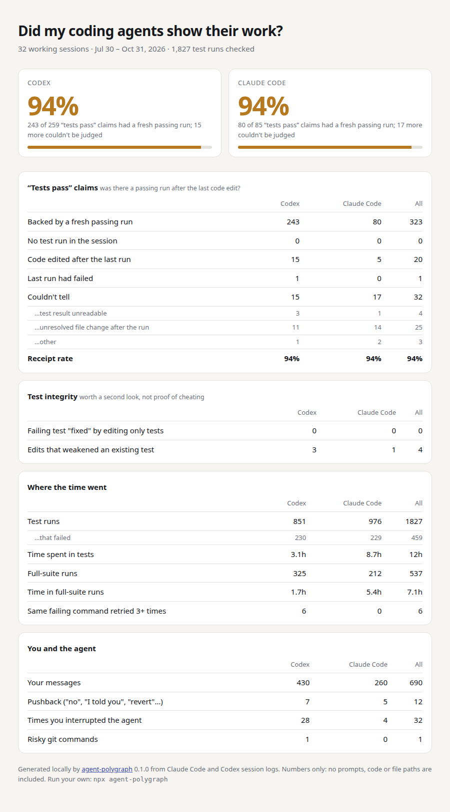
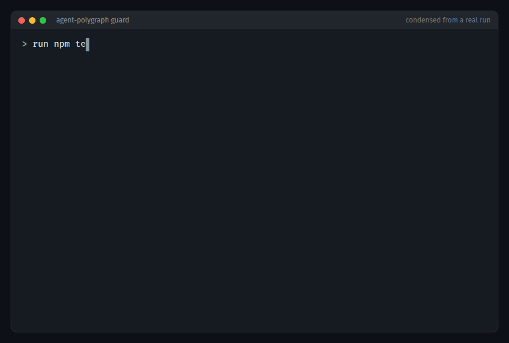

# agent-polygraph

[](https://github.com/EleChon-pixel/agent-polygraph/actions/workflows/test.yml)

Check whether your coding agent's test claims have evidence—and optionally run the tests before it stops.

agent-polygraph reads Claude Code and Codex session logs on your machine. Its audit checks detected passing-test claims against the available runs and edits, then shows the evidence behind each verdict. No API key or setup is needed for the default audit, and it uploads nothing.

```sh
npx --yes agent-polygraph          # audit your own sessions
npx --yes agent-polygraph --demo   # generated sample sessions
```

The audit does not execute tests. The optional guard offers three policies:

| Policy | Executes tests? | What happens at Stop |
|---|---|---|
| `claims` (default) | No | Challenges definitely unbacked passing-test claims once; allows ambiguous evidence. |
| `strict` | No | Also challenges inconclusive passing-test claims; surfaces unresolved repeated claims. |
| `verify` | Yes | Runs your configured project command regardless of claims, retests repairs, and reports unresolved verification after a bounded repair budget. |

A flagged claim means the available evidence does not support it at that point. It does not establish that the code is broken or the agent intended to mislead you. A passing verification establishes only that your chosen command passed on the observed inputs.

To enable executable verification, use a persistent installation and run this in the project you want checked:

```sh
npm install -g agent-polygraph
agent-polygraph guard --install --mode verify --test-command "npm test"
agent-polygraph guard --status
```

Replace `npm test` with the command that checks your project. Verification requires a Git checkout for complete fingerprints. Existing installations and the Claude plugin keep the default claim-only policy until explicitly reconfigured. See [guard policies](#guard-policies-optional) for timeouts, repair budgets and caching.

> **Beta / evidence limitations:** The parser has been evaluated on the author's own sessions and public Claude Code traces ([evaluation](docs/evaluation.md)). Controlled replays and real executed tests exist, but **independent, blinded human-validated accuracy has not been established**. If you report a wrong verdict, [open an issue](https://github.com/EleChon-pixel/agent-polygraph/issues/new/choose) with a *manually redacted* example—never upload an unreviewed raw session log.

<details>
<summary>Historical example: the author's sessions, July–October 2026</summary>

This is not a representative benchmark or a current-user measurement.

```
agent-polygraph  32 working sessions · Jul 30 – Oct 31, 2026 · 11.0s

"Tests pass" claims  was there a passing run after the last code edit?
                                                    Codex  Claude Code          All
  Backed by a fresh passing run                       243           80          323
  No test run in the session                            0            0            0
  Code edited after the last run                       15            5           20
  Last run had failed                                   1            0            1
  Couldn't tell                                        15           17           32
  …test result unreadable                               3            1            4
  …unresolved file change after the run                11           14           25
  …other                                                1            2            3
  Receipt rate                                        94%          94%          94%

Test integrity  worth a second look, not proof of cheating
  Failing test "fixed" by editing only tests            0            0            0
  Edits that weakened an existing test                  3            1            4

Where the time went
  Test runs                                           851          976         1827
  Time spent in tests                                3.1h         8.7h          12h
  Full-suite runs                                     325          212          537
  ...
```

Under the tables it prints the latest examples: what the agent claimed, the last test command and its result, what was edited afterwards, and the session file, so you can check it yourself.

</details>

**Controlled policy comparison:** In [12 authored scenarios with actual test executions](docs/live-evaluation.md), seven final suites failed:

| Policy | Extra test executions | Failing final suites detected |
|---|---:|---:|
| Claim-only guard (`claims`) | 5 | 3/7 |
| Executable guard (`verify`, cache off) | 12 | 7/7 |
| Always rerun the complete suite | 12 | 7/7 |

Executable verification closes the demonstrated claim-only coverage gap by running the suite, at the same test-invocation cost as always-rerun plus fingerprint/state overhead. This is a controlled regression result, not an independent accuracy estimate or a general speedup. The [25-case replay](docs/benchmark.md) separately checks claim freshness against a simple any-prior-pass rule; [public-session projections](docs/benchmark.md) estimate workload rather than executed test cost. The independently labeled human study is [still open](https://github.com/EleChon-pixel/agent-polygraph/issues/3).

**npm distribution:** Run the latest published release with `npx --yes agent-polygraph --demo`. To find the currently published version before pinning one, use `npm view agent-polygraph version`. The GitHub `main` branch may be ahead of npm. Releases use GitHub OIDC trusted publishing and require maintainer 2FA approval before going live. The [automated public-install check](.github/workflows/verify-published-npm.yml) tests the download from npm, not just the repository source. See [Release instructions](docs/releasing.md).

## Explain a specific finding and check your setup

Both commands are available in the published npm package. Run them using `npx --yes agent-polygraph explain` and `npx --yes agent-polygraph doctor`, or use `agent-polygraph` directly after a global installation.

```sh
agent-polygraph explain --since 7d --limit 10  # show flagged or uncertain claims and their evidence
agent-polygraph explain --session abc123        # narrow by session ID prefix
agent-polygraph doctor                         # check installed hooks, logs and recorder settings
```

`explain` shows the claim, available last-test evidence, relevant subsequent edit and why a result is inconclusive. It is **read-only**, does not run tests, and may print private transcript excerpts, commands and paths. **Do not share its output without reviewing/redacting it.** Use `explain --ci` only if you want to ask GitHub for additional CI evidence.

`doctor` inspects local transcript discovery, a small sample of log formats, project/global hook settings, and recorder-directory permissions. It **never modifies settings or installs hooks**. An uninstalled direct hook is informational: the guard is optional and the Claude Code plugin may supply one separately. The default is offline; `doctor --ci` explicitly checks whether your GitHub CLI login is available, which may contact GitHub. This is a diagnostic, not a complete security audit.

## Share your numbers

```sh
npx agent-polygraph --html
```

This writes `polygraph.html`, a self-contained card with numbers only. Prompts, code, commands and file paths are left out.



## Guard policies (optional)

```sh
npx agent-polygraph guard --install            # this project (.claude/settings.json, .codex/hooks.json)
npx agent-polygraph guard --install --global   # every project (~/.claude, ~/.codex)
npx agent-polygraph guard --uninstall
```



The default `claims` policy is a Stop hook that runs the audit checks on the live session. When the agent's final message says tests pass and the session doesn't back it up, the agent is sent back once:

> agent-polygraph: your final message says "All tests pass.", but you edited calc.js after the last test run. Run the relevant tests now and report the actual result. If they can't be run, say so instead of claiming they pass.

The `claims` policy requests one corrective continuation, looks only at the final message (so a claim the agent already corrected doesn't count), stays quiet when it can't tell, and never fails the turn because of its own errors. Install it globally (`npm i -g agent-polygraph`) so the hook doesn't start `npx` on every stop.

I tested the claim-only policy with both agents in a staged setup: they were told to edit code after a test run and then claim the tests pass (the GIF above is one of these runs). Both were stopped, reran `npm test` and reported the failure. Codex needs one extra step: it only runs hooks you have approved, and only reads a project's `.codex/` folder if you trust it. After installing, open `codex` in the project once, trust the folder and approve the hook.

### Verify the project even when the agent makes no test claim

Choose the test command yourself when installing the project hook:

```sh
agent-polygraph guard --install --mode verify --test-command "npm test"
agent-polygraph guard --status
```

`verify` runs that command in the fixed installation folder at every Stop, including continued stops. A fresh passing result permits stopping. A failure sends the agent back to repair the cause, and the command runs again afterward. The default budget is **two consecutive attempts per repair cycle** (reset after a pass or a new human turn). If verification is still failing or inconclusive, the hook stops automatic continuation and displays an unresolved result requiring manual attention. Changing the final answer or setting `stop_hook_active` does not bypass executable verification.

The default command deadline is 60 seconds (`--timeout 1..300`). Pass caching is **off**. For slow, locally deterministic suites you can opt into `--cache-seconds 60`: a pass can be reused only for the same configured command/session, an unchanged Git working-tree fingerprint and environment, and within that lifetime. Configuration, tests, source and other non-ignored files are included. Ignored files and external services are not fingerprinted, so leave caching off when they can affect results.

The before/after fingerprints must be complete and match. A timeout, unreadable snapshot, oversized or linked file, or net file change during testing leaves verification inconclusive. The default `--on-unknown stop` challenges it within the same bounded budget. `--on-unknown warn` explicitly permits an inconclusive stop with a warning; it never records a pass. Verification needs a Git checkout for complete fingerprints. Generated test outputs should be ignored so producing a report does not look like changing the tested inputs. Before/after comparisons detect net changes, not transient changes reverted during a run.

The selected command is the coverage contract: choose the full suite if that is what you want enforced. The guard cannot establish that a weak test detects every bug. It does not choose commands from the agent's messages or automatically execute a repository-discovered configuration. The installed hook stores the approved policy, including its fixed folder, and Codex requires review when that hook definition changes. Executable mode is project-specific; `--global` is rejected. Test processes run with your normal hook permissions; this is not a sandbox or a defense against an agent that can edit its own hook configuration.

`guard --status` shows local outcomes, execution counts and repair attempts. Receipts contain hashes, timing and outcomes, not command text, source or raw output. A crashed hook may leave a lock; inspect the process and status before removing that lock from the private guard directory. The existing `doctor` command still checks hook wiring.

For transcript-only checking with visible ambiguity, use `guard --install --mode strict`. It also challenges inconclusive passing-test claims and surfaces unresolved repeated claims. It does not run tests or discover unclaimed failures. The default `--mode claims` retains the original one-cycle, definite-claim-only behavior; the plugin uses that default unless a project install overrides it.

### Which policy should you use?

- Use the **audit** to investigate past sessions without running tests or changing agent behavior.
- Use **`claims`** when you want occasional verification requests and accept that unclaimed failures and ambiguous evidence can pass through.
- Use **`strict`** when you want ambiguous passing-test claims challenged, while retaining transcript-only operation. It still cannot discover unclaimed failures.
- Use **`verify`** when the chosen suite should run before the agent stops, including after repairs. With caching off it incurs test execution on each Stop within the repair budget. It adds local receipts, fingerprint checks and bounded recovery to a test-running hook.

A plain Stop hook that runs your suite is also a reasonable choice for a simple project. Neither policy is a better defect detector than the tests it executes. Optional caching can reduce repeated executions of deterministic local suites, but it adds assumptions about unchanged ignored inputs and external services.

### As a Claude Code plugin

In Claude Code you can install the guard as a plugin instead:

```
/plugin install agent-polygraph --marketplace EleChon-pixel/agent-polygraph
```

On Claude Code older than 2.1.275, run `/plugin marketplace add EleChon-pixel/agent-polygraph` first, then `/plugin install agent-polygraph@agent-polygraph`.

The plugin runs the `claims` Stop hook from its own copy, so nothing is downloaded when the agent stops, and it adds `/agent-polygraph:check` for the report (it takes the same options, for example `/agent-polygraph:check --since 30d`). If you also installed the hook with `guard --install`, the plugin's copy stays quiet so the agent isn't sent back twice. The plugin doesn't include `record`; turn that on separately if you want it.

## Evidence the logs don't have

Some things never show up in the logs: tests you ran yourself in another terminal, CI results, and files changed by a script that builds their names at run time. Optional recording and GitHub CI evidence can reduce those gaps for retrospective analysis. Executable verification provides a separate current test run; its status receipts are not imported into the retrospective claim report.

```sh
npx agent-polygraph record --install           # this project; add --global for all of them
agent-polygraph record --install --shell       # your own terminals (requires a persistent install)
npx agent-polygraph --ci                       # GitHub Actions (online)
```

`record --install` adds a PostToolUse hook to Claude Code and Codex. After a test or a command that may write files, it records the test outcome and an HMAC-fingerprinted source snapshot. The snapshot reads bounded source files without writing copies to Git or storing raw contents. Ignored and non-source files are excluded; symlinks, unreadable files and exceeded size limits make a snapshot inconclusive. Comparing snapshots can resolve scripts that modify dynamically chosen source files. All new records stay in `~/.agent-polygraph` (or `$AGENT_POLYGRAPH_HOME`). Recording starts with new sessions.

`record --install --shell` adds one line to `~/.bashrc` and `~/.zshrc`. Supported test commands you run in interactive Bash/Zsh shells produce a minimal receipt: runner category, working directory, timestamps, exit code and a scope classification. Only an allowlist of exact unfiltered invocations establishes full-suite scope; targeted or unfamiliar arguments and older category-only receipts cannot verify a full-suite claim. Raw commands and output are never saved. To avoid unsafe shell redirection, the shell hook invokes the installed Node CLI, which validates and writes the receipt with private permissions and no-follow checks. **Use a persistent installation** (`npm i -g agent-polygraph` or a durable checkout) for shell integration; temporary `npx` cache paths may disappear. Shell mode recognizes a conservative subset of direct test commands. `record --uninstall --shell` removes its startup line.

`--ci` goes online. Through your [`gh`](https://cli.github.com) login, it asks the GitHub API for the workflow runs of the repositories your sessions pushed to. The request contains the repository name and a date range, nothing from your sessions. A test workflow on a pushed commit counts as a test run of the code as it was at the push, so later edits still make it stale. Runs are matched to pushes by commit id, which has to appear in the session (in the push output, or from `git commit` or `git log` before it). Branch names and timing alone are not enough. With `--ci`, claims about CI itself ("CI is green", "all checks on the PR pass") are checked too. Workflows with no job or step named like a test, and runs GitHub never started, are ignored.

The report shows how many claims each of these settled.

## What the retrospective audit checks

| Finding | How it's decided |
|---|---|
| Backed claim | The agent said tests pass and the run it refers to passed. That is the run with the count or test file the claim names; for "the full suite passes", the latest run in that folder about as large as the largest one; otherwise the latest result the agent had seen. The run must have started after the last edit to a source file in the same checkout. |
| Code edited after the last run | A test ran, the agent then changed source code in that checkout (with an edit tool, a patch or the shell), and claimed tests pass without running them again. An edit made while the run was still going counts too. |
| Last run had failed | The latest test result in the session showed failures. A subagent's failing run in its own worktree is "couldn't tell" instead. |
| No test run | The agent changed code but ran nothing recognisable as a test before the claim. |
| Couldn't tell | Left out of the receipt rate, with the reason shown: the result can't be read (piped, truncated, mixed with other output), a file changed in a way that can't be traced (a script with no file name in it, `git checkout`, `git merge`), the test was still running, a subagent's run failed in its own worktree, or nothing in the session changed code. |
| Failing test "fixed" by editing only tests | A run failed, the agent changed a test it hadn't touched before, changed nothing else, and the next run passed. Fixing a test the agent just wrote doesn't count. Sometimes the test was wrong, so this is a flag to look at, not a verdict. |
| Weakened an existing test | An edit to a test that existed before the session removed cases or assertions, added `skip`/`xfail`, `.only` or an always-true assertion, or deleted the file. |
| Full-suite runs | A test command with no file, directory, node id or `-k` filter. |
| Retry loops | The same failing command run 3 or more times in a row with no edit in between. |
| Pushback and interrupts | Your messages that start with "no", "stop" or "revert" or contain "I told you", and turns you interrupted. |
| Risky git | `--no-verify`, `push --force`, `reset --hard`, discarding uncommitted changes. |

Background runs are followed: Claude Code's `run_in_background` results (the notification and the output file the agent reads) and Codex cells that finish later through `wait`.

## How it decides

Retrospective verdicts use deterministic pattern matching, without an LLM. The same transcripts and supplemental inputs produce the same analysis; persisted output files, recorder evidence and online CI results can change those inputs. Ambiguous audit evidence is reported as "couldn't tell". Guard handling of uncertainty depends on its selected policy.

- Each command's start and its result are separate events, in the order they were observed. A claim can only be backed by a result the agent had already seen. A run covers the code as it was when the run started, so an edit during the run makes it stale.
- In a Codex cell that runs several commands, each command gets its own output. If outputs can't be matched to commands, the result stays unknown.
- An edit counts once it happened: a Claude Code edit after its tool result confirms it, a Codex patch if it applied. Shell writes count too (`sed -i`, redirects, `tee`, `cp`/`mv`, scripts that write named files), placed by the `cd` in effect where they appear.
- A script's writes are the files it clearly writes, such as `open('x.py', 'w')`, `Path('x.py').write_text(...)`, `writeFileSync('x.js', ...)`, or a variable holding such a path that is written later. Files it only reads don't count. A write to a file it can't name (a loop over paths, `extractall`, `shutil.copy` to a variable) makes the claim "couldn't tell".
- In the retrospective audit, an edit in one checkout or worktree does not make a run in another stale. Only recognized source-file edits count; docs, config, data, generated output and hidden tool folders are excluded. Executable verification separately fingerprints all enumerated non-ignored working-tree files, including configuration and data.
- `tail pytest.log` is evidence about the run that wrote `pytest.log`, not a new run.
- Results come from the runner's summary line first (`3 failed, 10 passed in 1.2s`, `Tests: 1 failed`, `test result: FAILED`). An exit code is trusted only when the test ran last (`cd app && pytest`, `ruff check .; pytest`) or a plain `&&` chain exited 0. `npm test; true` exits 0 because of `true`.
- Commands refused by a permission prompt, the auto-mode classifier or a hook never ran, so they aren't test runs.
- Every detected claim sentence in a message is checked separately. The guard quotes a claim that actually lacks evidence, even when another claim in the same message is backed.
- Runs in an unrelated checkout do not back the current project. Subagent runs retain their own working directory; ambiguous project scope is left unknown.
- A claim is a sentence like "all tests pass" or "62 passed". Plans ("I'll make sure the tests pass"), conditions ("once tests pass"), history ("the latest recorded run passed"), questions, partial results ("58 of 59 pass") and quoted runner output are ignored. English is supported, plus simple forms in Greek, Spanish, Portuguese, German, French and Italian.
- Subagent transcripts are merged into the parent session. A subagent's passing run can supply evidence when its directory and scope are relevant; an unrelated worktree is not proof of a pass in the parent checkout.
- Tests the agent created in the same session can't be "weakened". A Claude Code `Write` over an existing test is an overwrite, so it can.
- Transcript-only guard policies judge the final message. "Correction: I did not run the tests" after an earlier claim does not trigger a claim-based block. Executable verification runs its configured command independently of the final wording.

The rules are in [`src/classify.js`](src/classify.js) and the tests in [`test/`](test), including a labelled set of claim and non-claim sentences ([`test/claims.corpus.test.js`](test/claims.corpus.test.js)). A false positive or a missed claim makes a good [issue](https://github.com/EleChon-pixel/agent-polygraph/issues/new/choose); include the redacted sentence and it goes into that set.

## Validation and accuracy

The historical analysis of the author's own Claude Code and Codex sessions includes manual spot checks of claims and flagged evidence. In a small, author-selected review, approximately 95% of 25 detected claim candidates were genuine claims, and a separate sample suggested some real claims were missed. **These are preliminary, author-reviewed observations, not externally validated precision or recall.** See the [original evaluation protocol](docs/evaluation.md).

The public Claude Code evaluation reviewed 26 parsed sessions and identified 24 backed claims and three stale findings (one confirmed and two considered likely). It is useful for parser regression coverage but does **not** establish accuracy on an independent, representative population. A separately pinned, redacted holdout audit inspected 103 public sessions; under its conservative automated reference rules, **no eligible claims were found**, so **no holdout accuracy percentage was produced**. Additional dataset limitations and exact counts are documented in [live-evaluation.md](docs/live-evaluation.md).

Two reproducible controlled experiments test narrower propositions:

- [Stop-hook replay](docs/benchmark.md): 25 authored Claude Code/Codex scenarios. Agent-polygraph correctly blocked 14/14 labeled unbacked claims versus 7/14 for a naive “any test passed earlier” hook, with zero false blocks in these selected cases.
- [Executed-test policy comparison](docs/live-evaluation.md): 12 authored scenarios with actual Node.js test executions. The claim-only guard required five extra test executions and detected three of seven failing final suites. Both executable verification with caching off and always-rerun required 12 executions and detected all seven.

The replay labels and scenarios were constructed by the project authors. Transcript-only guard policies cannot discover failures without a relevant passing-test claim. Executable verification runs the chosen command regardless of claims, but its coverage depends on that command and the tests themselves. **An independent, blinded human evaluation is still needed.** The [review issue](https://github.com/EleChon-pixel/agent-polygraph/issues/3) describes the protocol; `scripts/blind-review.mjs` prepares prediction-free review packets. No raw private session logs should be shared with reviewers or issues without permission and redaction.

## Limits

The retrospective audit depends on recorded evidence; `record` and `--ci` can reduce gaps. Executable verification instead runs a current command, with the fingerprint, timeout and caching limits described above. None of these establishes overall code correctness.

- Tests outside the logs. Tests the agent ran, test runs Claude Code recorded from hooks, commands you typed with `!` in Claude Code, and test output you pasted into the chat all count. So do your own bash and zsh runs with `record --shell`, and GitHub Actions runs on pushed commits with `--ci`. Other shells (fish, PowerShell, an IDE's test button), other CI services, and CI runs on commits the session never printed are still invisible.
- "The full suite passes" prefers an explicitly recognized full-suite command in the same folder, even when no count was printed. If the only observed run is targeted and there is no full-suite evidence, the result is **inconclusive**, not backed. Count-based heuristics still help when the runner cannot reliably identify the suite's scope. A passing test run is evidence of that run, never proof that all code works.
- Output with no summary. Codex keeps each command's full output. Claude Code may save long output to a separate file that the analyzer reads if it still exists. New `record` entries retain **parsed test outcomes and pass counts, not raw test output**. A run abandoned before printing a result leaves nothing to read.
- Files a script names at run time. Without `record` these make a claim "couldn't tell", never "backed". `record` settles them, but only in git checkouts and only for sessions after it was installed.
- New agent versions can change the log format. Supported: Claude Code 2.x (Bash and PowerShell tools; Linux, macOS and Windows paths) and Codex CLI. The report lists the versions it read, warns about newer ones, and counts files it couldn't parse instead of dropping them silently.
- Unbacked is not the same as false. "Code edited after the last run" means the claim wasn't verified after the edit; the edit may have been harmless, such as a comment or a test file. The retrospective report cannot establish whether the tests would have passed at that point. A later successful verification does not retroactively establish what evidence the agent had when it made the original claim.
- The numbers describe your sessions, projects and prompts. They are not a benchmark of the models.

## Options

```
--since <when>      only sessions since a date (2026-10-01) or age (7d, 4w, 3m)
--project <text>    only sessions whose working directory contains <text>
--exclude <text>    skip sessions whose id starts with, or whose working directory contains, <text> (repeatable)
--agent <name>      claude or codex (repeatable; default: both)
--by <col>          compare by "agent" (default) or "model"
--examples <n>      examples to show per finding type (default 3, 0 to hide)
--html [file]       write a numbers-only report to share (default polygraph.html)
--json              full results as JSON: findings, unclear reasons, unreadable files (keep it local)
explain             investigate flagged/uncertain verdicts (--limit, --since, --session, --project)
doctor              check local hooks, transcript availability and recorder permissions
guard --status      inspect local executable-verification receipts
--ci                also use GitHub Actions results (goes online, through your gh login)
--claude-dir <dir>  Claude Code projects dir (default ~/.claude/projects, or $CLAUDE_CONFIG_DIR/projects)
--codex-dir <dir>   Codex sessions dir (default ~/.codex/sessions, or $CODEX_HOME/sessions)
```

## Running the repository version

The GitHub source and the npm-distributed package are different delivery paths. To try the **current `main` code** without assuming npm is up to date:

```sh
git clone https://github.com/EleChon-pixel/agent-polygraph.git
cd agent-polygraph
node bin/polygraph.js --demo
npm test
npm run benchmark:replay
npm run benchmark:live
```

Before distributing a new version, compare `npm view agent-polygraph version` with `package.json`, inspect the release tarball (`npm pack --dry-run`), and verify that a clean public npm install contains the intended fixes. Development on `main` can contain unreleased changes, so a green GitHub Actions badge **does not** prove npm has been updated.

## Privacy

New recordings intentionally minimize local data. The agent hook stores a keyed command fingerprint, the runner's result and optional fingerprints of source files. It does **not** save raw command text, test output or copies of repository files in its snapshot store. The shell integration saves a recognized test-runner category, time, folder, exit code and full/unknown scope classification. Executable verification saves hashed identifiers, a working-tree/environment fingerprint, outcomes, timestamps and execution/attempt counts under `~/.agent-polygraph/guard`; it stores no raw command, test output or source contents in those receipts. The approved executable command is stored in the installed hook configuration. Local record files, key and snapshot metadata are owner-only on Unix. Hook settings and shell startup files are replaced atomically, preserving their permissions and creating private recovery backups under `~/.agent-polygraph/backups` (see [recovery](docs/releasing.md#recovery-for-installed-hooks)). The secret fingerprint key is stored in `$AGENT_POLYGRAPH_HOME/record-key` (default `~/.agent-polygraph/record-key`).

**Legacy recordings:** older recorder formats may include full commands, and earlier versions may have created a local Git object store with duplicate source contents. Upgrading does **not** remove those files. After reviewing whether you still need the historical evidence, uninstall recording and manually remove the old `~/.agent-polygraph/records` and `~/.agent-polygraph/objects` directories. Removing historical records means those sessions will lose their supplemental evidence; the original Claude Code/Codex transcripts remain untouched. Do not delete `record-key` while retaining version 2 records that rely on matching fingerprints.

Stored fingerprints are **not** a guarantee of anonymity: recording metadata includes timestamps, working directories and relative source-file paths, and existing v1 records may still contain raw commands. The original Claude Code/Codex transcripts can also contain secrets and confidential data. The terminal report and `--json` may quote transcript text and paths; do not share them without review. The `--html` report intentionally excludes excerpts, prompts, commands and paths. The recorder only supports bounded source-file snapshots in Git checkouts and skips symbolic links; when evidence cannot be read it must stay inconclusive rather than certifying a pass. New source-file fingerprints include relative filenames and are not an anonymization guarantee.


The default audit reads local files and works offline. These additional operations are opt-in:

- `guard` and `record` edit the hook config files they print when you install or uninstall them, and `record --shell` adds or removes one marked line in `~/.bashrc` and `~/.zshrc`.
- `record` saves snapshots and logs in `~/.agent-polygraph`.
- `guard --mode verify` executes your selected command with the hook's normal permissions and writes local verification receipts. That command can itself access the network, modify files or produce artifacts; the guard does not sandbox it.
- `--ci` and `explain --ci` contact api.github.com through `gh` and send repository names and date ranges.

The terminal report and `--json` include excerpts from your sessions. `--html` doesn't.

## License

MIT
